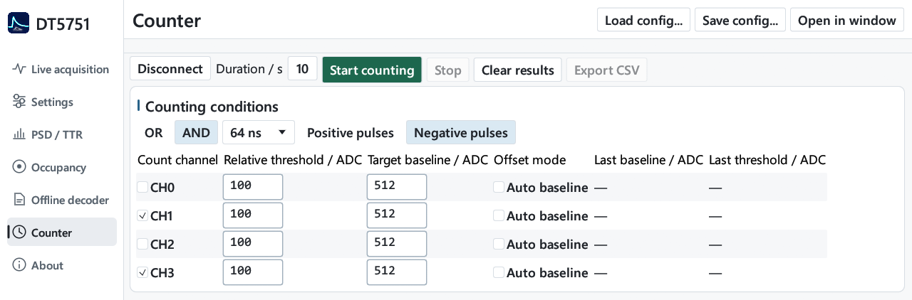

# CAEN DT5751 Readout GUI

[English](README.md) · [简体中文](README.zh-CN.md)

View four detector waveforms together, measure coincidence rates and follow pulse-shape spectra while acquiring data over USB.

**v2.1.20**　 [Windows 10/11 x64](https://github.com/jack595/DT5751-Readout-GUI/releases/download/v2.1.20/DT5751_Setup_v2.1.20.exe)　·　[Windows 7 SP1 x64](https://github.com/jack595/DT5751-Readout-GUI/releases/download/v2.1.20/DT5751_Setup_Win7_x64_v2.1.20.exe)　·　[User manual](docs/Manual-en.md)　·　[PDF](docs/Manual-en.pdf)

**Before installing**　The board needs the D-WAVE Waveform Recording firmware used by WaveDump. CoMPASS DPP firmware (including DPP-PSD) is incompatible. Windows 7 requires an existing compatible CAEN USB driver.

## Start at the bench

| Task | Where to start |
| --- | --- |
| Read the first waveform | [Connect, apply settings, start monitoring, then send a software trigger](docs/Manual-en.md#2-read-your-first-waveform) |
| Record coincident waveforms | [Select the participating channels and coincidence window](docs/Manual-en.md#4-measure-a-coincidence) |
| Measure trigger rate | [Run single-channel, OR or AND counting and export CSV](docs/Manual-en.md#10-counter) |
| Record a sequence of runs | [Set cycle duration, sleep time, data format and destination](docs/Manual-en.md#5-record-repeat-and-replay) |
| Monitor pulse shape | [Choose baseline, total and tail gates for live PSD/TTR](docs/Manual-en.md#6-analyze-pulses-with-psdttr) |
| Check detector occupancy | [Count waveforms crossing threshold in a chosen window](docs/Manual-en.md#7-monitor-occupancy) |
| Compare light yield | [Fit peaks and compare aligned mean waveforms in the optional plugin](docs/Manual-en.md#8-compare-light-yield-offline) |
| Convert recorded BIN to ROOT | [Build and run BinaryFileV2ToROOT](docs/Manual-en.md#9-convert-recorded-waveforms-to-root) |

## Measure coincidences

Select CH1 and CH3 directly in Counter, choose AND, and set a 64 ns window. Start counting applies the thresholds for this measurement. Historical tests with synchronous inputs reached 10 MHz on the tested DT5751. [Setup and hardware results](docs/Manual-en.md#10-counter)

## Analyze during and after a run

| Live PSD/TTR | Light yield plugin |
| --- | --- |
|  |  |
| Compare charge integrals and tail fractions as events arrive. Simulated input. | Review Gaussian fits across samples, then export a table or interactive report. Synthetic spectra shown. |

[All releases](https://github.com/jack595/DT5751-Readout-GUI/releases) · [SHA-256](https://github.com/jack595/DT5751-Readout-GUI/releases/download/v2.1.20/SHA256SUMS.txt) · [BIN-to-ROOT converter](https://github.com/jack595/CAEN_DT5751_ReadoutIntoROOTFile)

© 2026 Xiaojie Luo and ChatGPT
