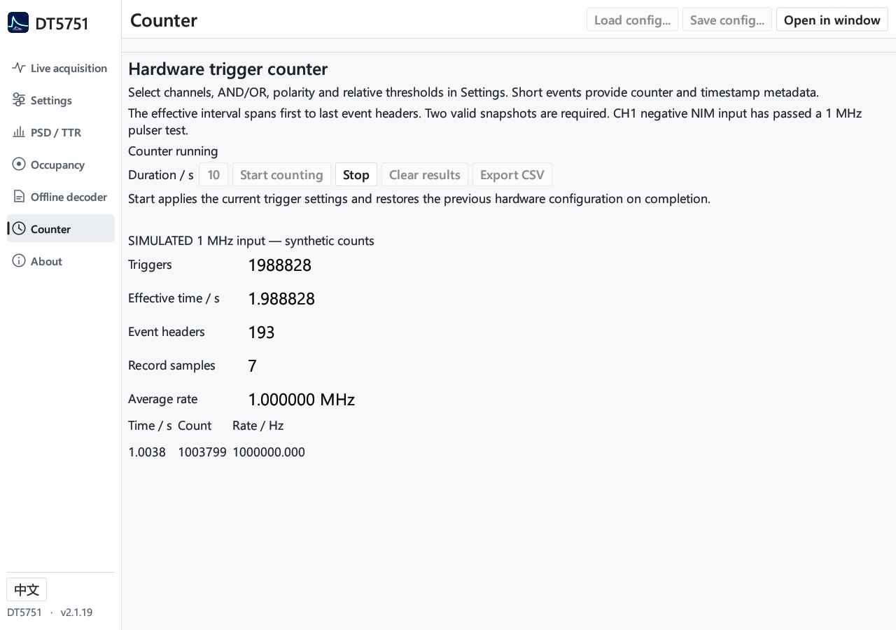
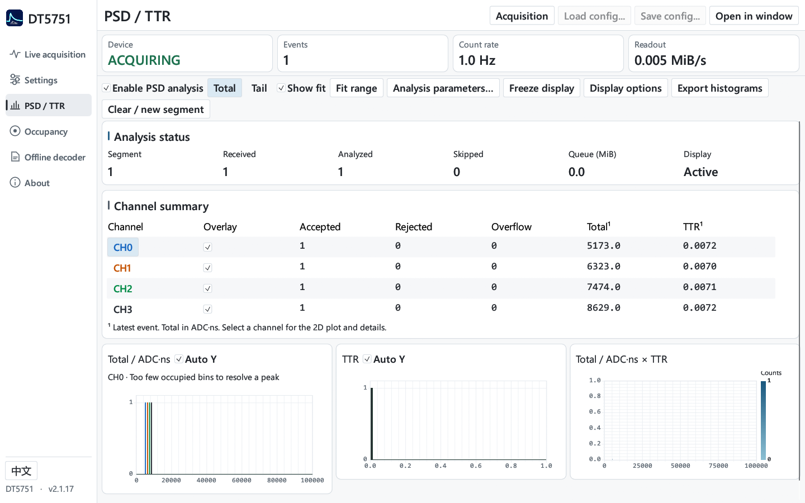

# DT5751 Readout GUI

[English](README.md) · [简体中文](README.zh-CN.md)

Read four waveforms together, check coincidence timing and compare charge spectra and pulse shapes during acquisition.

**Firmware requirement**　Use **D-WAVE Waveform Recording firmware**, as used by WaveDump. CoMPASS DPP firmware, including DPP-PSD, is incompatible. PSD runs on the host PC. [CAEN WaveDump](https://caen.it/products/wavedump/) · [CoMPASS](https://caen.it/product/compass/)

[Windows 10/11 x64](https://github.com/jack595/DT5751-Readout-GUI/releases/download/v2.1.19/DT5751_Setup_v2.1.19.exe)　|　[Windows 7 SP1 x64](https://github.com/jack595/DT5751-Readout-GUI/releases/download/v2.1.19/DT5751_Setup_Win7_x64_v2.1.19.exe)　|　[User manual](docs/Manual-en.md)　|　[PDF](docs/Manual-en.pdf)

Windows 7 requires an existing compatible CAEN USB driver. Installation and USB readout require verification on the target Win7 PC.

## Hardware trigger counter

v2.1.19 adds timed trigger counting and fixes USB readout of odd-word single-channel events. Select a channel or an AND/OR group, set relative thresholds, measure for 10 seconds by default and export CSV.

CH1 negative NIM input passed 1 MHz and 10 MHz tests. Synchronous CH1/CH3 input measured approximately 10.000044 MHz in single-channel, OR and 64 ns AND modes, with threshold-inhibition controls. These results cover the tested input conditions.

Counter interface with labelled synthetic 1 MHz data. Physical input results are documented in the manual.

## Four simulated channels in the live acquisition view.

Connect → Apply configuration → Start monitor. Use software triggers to verify readout, then select the detector trigger.

## Live PSD workspace in simulation mode.

Set baseline and integration gates per channel. Compare Total, Tail and TTR, or inspect the two-dimensional distribution.

## Two synthetic spectra fitted by the plugin.

Install the optional Light yield plugin to compare batches, review Gaussian fits and export tables and reports.

## Convert recorded waveforms to ROOT

Choose **Compressed BIN** when recording. After stopping the run, use **BinaryFileV2ToROOT** on Linux or WSL to write one run or cycle’s waveforms and trigger times to ROOT. [Converter repository](https://github.com/jack595/CAEN_DT5751_ReadoutIntoROOTFile) · [Build and run instructions](docs/Manual-en.md#9-convert-recorded-waveforms-to-root)

[All releases](https://github.com/jack595/DT5751-Readout-GUI/releases) · [SHA-256](https://github.com/jack595/DT5751-Readout-GUI/releases/download/v2.1.19/SHA256SUMS.txt)

© 2026 Xiaojie Luo and ChatGPT
