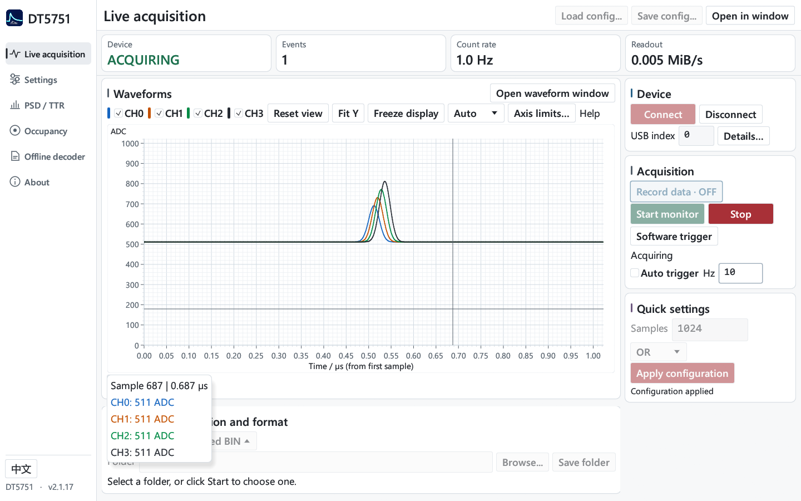
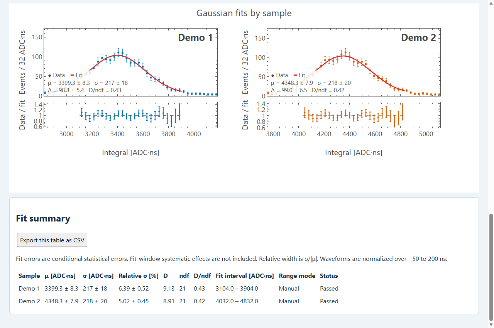

# DT5751 Readout GUI

[English](README.md) · [简体中文](README.zh-CN.md)

Read four waveforms together, check coincidence timing and compare charge spectra and pulse shapes during acquisition.

**Firmware requirement**　Use **D-WAVE Waveform Recording firmware**, as used by WaveDump. CoMPASS DPP firmware, including DPP-PSD, is incompatible. PSD runs on the host PC. [CAEN WaveDump](https://caen.it/products/wavedump/) · [CoMPASS](https://caen.it/product/compass/)

[Windows 10/11 x64](https://github.com/jack595/DT5751-Readout-GUI/releases/download/v2.1.17/DT5751_Setup_v2.1.17.exe)　|　[Windows 7 SP1 x64](https://github.com/jack595/DT5751-Readout-GUI/releases/download/v2.1.17/DT5751_Setup_Win7_x64_v2.1.17.exe)　|　[User manual](docs/Manual-en.md)　|　[PDF](https://github.com/jack595/DT5751-Readout-GUI/releases/download/v2.1.17/Manual-en.pdf)

Windows 7 requires an existing compatible CAEN USB driver. Installation and USB readout require verification on the target Win7 PC.

## Four simulated channels in the live acquisition view.

Connect → Apply configuration → Start monitor. Use software triggers to verify readout, then select the detector trigger.

## Live PSD workspace in simulation mode.

Set baseline and integration gates per channel. Compare Total, Tail and TTR, or inspect the two-dimensional distribution.

## Two synthetic spectra fitted by the plugin.

Install the optional Light yield plugin to compare batches, review Gaussian fits and export tables and reports.

[All releases](https://github.com/jack595/DT5751-Readout-GUI/releases) · [SHA-256](https://github.com/jack595/DT5751-Readout-GUI/releases/download/v2.1.17/SHA256SUMS.txt)

© 2026 Xiaojie Luo and ChatGPT
