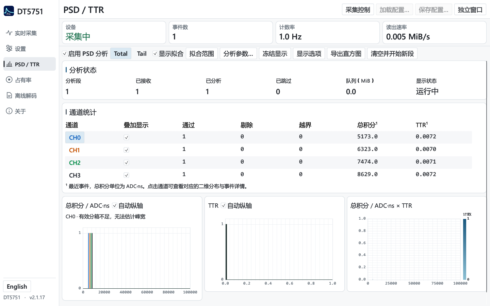

# DT5751 Readout GUI

[English](README.md) · [简体中文](README.zh-CN.md)

读取四通道波形，验证符合触发，并在取数过程中比较积分谱与脉冲形状。

**固件要求**　使用 WaveDump 对应的 **D-WAVE 波形记录固件**。CoMPASS 的 DPP 固件（含 DPP-PSD）不兼容。本软件在电脑端计算 PSD。 [CAEN WaveDump](https://caen.it/products/wavedump/) · [CoMPASS](https://caen.it/product/compass/)

[Windows 10/11 x64](https://github.com/jack595/DT5751-Readout-GUI/releases/download/v2.1.17/DT5751_Setup_v2.1.17.exe)　|　[Windows 7 SP1 x64](https://github.com/jack595/DT5751-Readout-GUI/releases/download/v2.1.17/DT5751_Setup_Win7_x64_v2.1.17.exe)　|　[图文手册](docs/Manual-zh.md)　|　[PDF](https://github.com/jack595/DT5751-Readout-GUI/releases/download/v2.1.17/Manual-zh.pdf)

Win7 需要已有兼容 USB 驱动，安装和 USB 取数仍需在目标机验证。

## 模拟采集中的四通道波形。

连接 → 应用配置 → 开始监测。先用软件触发验证读出，再切换到探测器触发。

## 模拟模式下的实时 PSD 工作区。

逐通道设置基线和积分窗，对比 Total、Tail、TTR，或查看二维分布。

## 插件对两组模拟能谱的拟合。

安装可选光产额插件，比较多个批次、复核高斯拟合并导出结果表和报告。

[全部发行版](https://github.com/jack595/DT5751-Readout-GUI/releases) · [SHA-256](https://github.com/jack595/DT5751-Readout-GUI/releases/download/v2.1.17/SHA256SUMS.txt)

© 2026 Xiaojie Luo and ChatGPT
