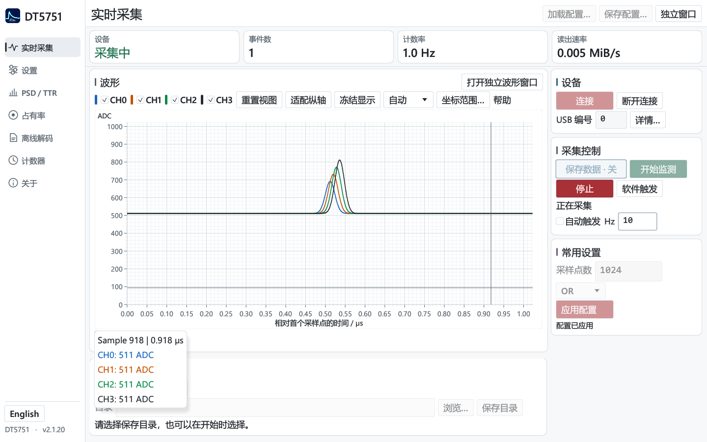
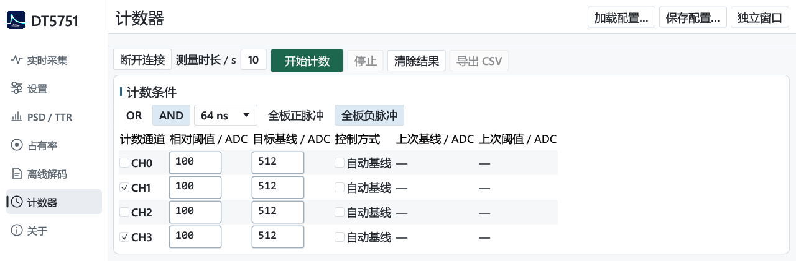
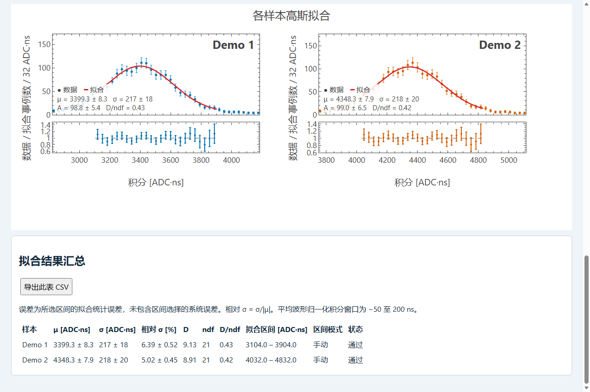

# CAEN DT5751 Readout GUI

[English](README.md) · [简体中文](README.zh-CN.md)

通过 USB 同时观察四路探测器波形，测量符合计数率，在采集中查看能谱和脉冲形状。

**v2.1.20**　 [Windows 10/11 x64](https://github.com/jack595/DT5751-Readout-GUI/releases/download/v2.1.20/DT5751_Setup_v2.1.20.exe)　·　[Windows 7 SP1 x64](https://github.com/jack595/DT5751-Readout-GUI/releases/download/v2.1.20/DT5751_Setup_Win7_x64_v2.1.20.exe)　·　[图文手册](docs/Manual-zh.md)　·　[PDF](docs/Manual-zh.pdf)

**安装前**　板卡需要 WaveDump 对应的 D-WAVE 波形记录固件。CoMPASS 的 DPP 固件（含 DPP-PSD）不兼容。Windows 7 需已有可用的 CAEN USB 驱动。

## 从上机到分析

| 要做什么 | 从哪里开始 |
| --- | --- |
| 读出第一条波形 | [连接、应用配置、开始监测，再发送软件触发](docs/Manual-zh.md#2-读出第一条波形) |
| 记录符合波形 | [勾选参与通道并设置符合窗](docs/Manual-zh.md#4-进行多通道符合测量) |
| 测量触发率 | [单路、OR 或 AND 计数，导出 CSV](docs/Manual-zh.md#10-计数器) |
| 周期记录 | [设置周期、休眠、格式和保存目录](docs/Manual-zh.md#5-记录周期测量与回放) |
| 观察脉冲形状 | [设置基线、总积分与尾积分窗，查看实时 PSD/TTR](docs/Manual-zh.md#6-设置-psdttr-积分和筛选) |
| 监测探测器占有率 | [统计指定时间窗内过阈的波形比例](docs/Manual-zh.md#7-监测占有率) |
| 比较光产额 | [在可选插件中拟合峰位、对比对齐后的平均波形](docs/Manual-zh.md#8-离线比较光产额) |
| 将 BIN 转成 ROOT | [编译并运行 BinaryFileV2ToROOT](docs/Manual-zh.md#9-将采集波形转换为-root) |

## 测量符合率

在计数器中直接勾选 CH1、CH3，选择 AND 和 64 ns 窗，点击开始计数即可应用本次阈值。该型号板卡在此前的同步信号实测中测到了 10 MHz。 [配置与实测条件](docs/Manual-zh.md#10-计数器)

## 在线监测与离线分析

| 在线 PSD/TTR | 光产额插件 |
| --- | --- |
|  |  |
| 随事件更新积分谱和尾总比。图中为模拟输入。 | 逐样品复核高斯拟合，导出结果表或交互报告。图中为模拟能谱。 |

[全部版本](https://github.com/jack595/DT5751-Readout-GUI/releases) · [SHA-256](https://github.com/jack595/DT5751-Readout-GUI/releases/download/v2.1.20/SHA256SUMS.txt) · [BIN 转 ROOT 工具](https://github.com/jack595/CAEN_DT5751_ReadoutIntoROOTFile)

© 2026 Xiaojie Luo and ChatGPT
