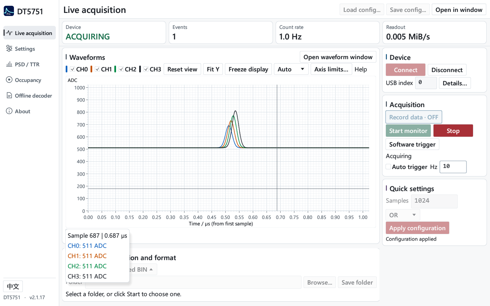
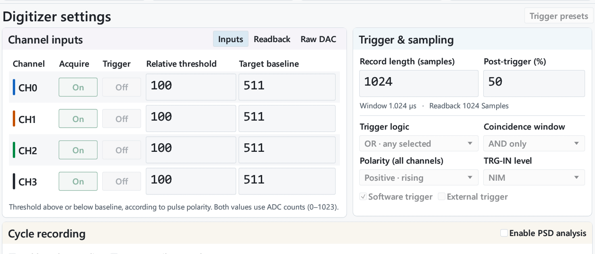
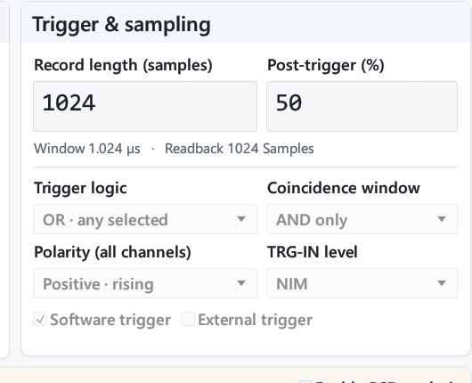
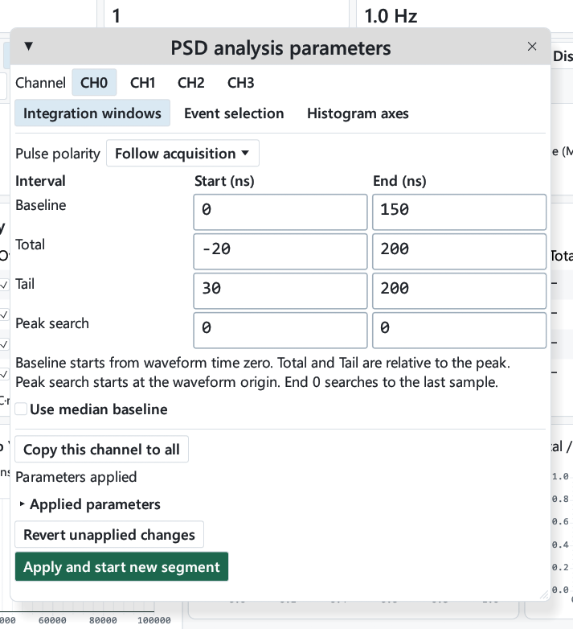
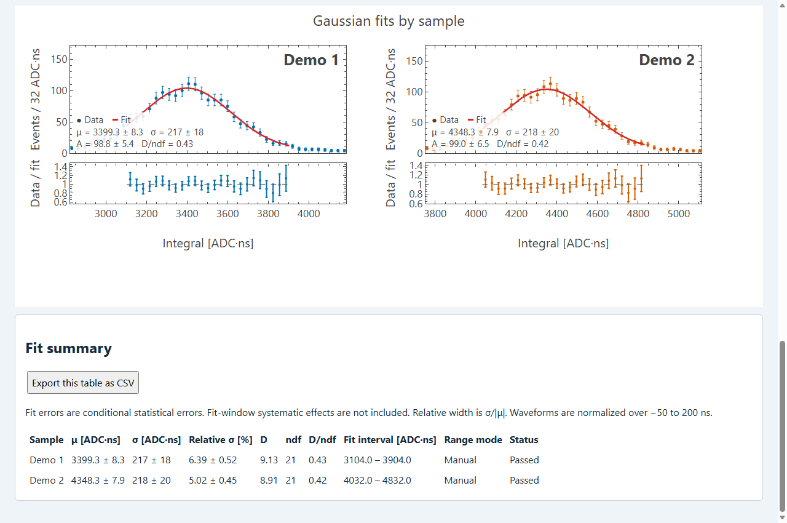

# DT5751 Acquisition and Analysis Manual

DT5751 2.1.17 · Light yield 1.3.5 · © 2026 Xiaojie Luo and ChatGPT

## 1. Install and connect

Use a four-input CAEN DT5751 in normal 1 GS/s waveform mode with **D-WAVE (Waveform Recording) firmware**, the firmware used by WaveDump. CoMPASS DPP firmware, including DPP-PSD, is incompatible. This application computes PSD on the PC from recorded samples. Check the board information in the vendor tool if the installed firmware is unknown. The installer sets up the PC; it does not flash the board.

1. Choose the standard x64 installer for Windows 10/11. Allow elevation to install the CAEN USB driver and Microsoft runtimes. On Windows 7 SP1 x64, use the Win7 installer on a PC with a working compatible CAEN USB driver and OpenGL graphics driver. The Win7 build passed import checks; native Win7 installation and USB readout still need verification on the target PC.
2. For the optional browser analysis, select **Full** or tick **Light yield offline analysis** during installation. Use a modern Edge or Chrome browser for the plugin.
3. Power the digitizer, connect it directly by USB and close WaveDump, CoMPASS or any other process holding the device. Launch DT5751, select USB index 0 for the first board and click **Connect**. Confirm model, serial and ROC/AMC in the connection details.
4. Connect detector pulses to analog CH0–CH3. Check signal amplitude, polarity and termination against the specifications of your particular DT5751. TRG-IN is a separate external logic input.

## 2. Read your first waveform

1. While stopped, open **Settings → Trigger presets → Software trigger test**. Select the channels to acquire, use a short record (e.g. 1024 samples) and click **Apply configuration**.
2. In Live acquisition choose a **Parent folder**, leave **Record data** off and click **Start monitor**. If prompted for a folder, select a writable local directory. Monitor previews events in memory.
3. Click **Software trigger**. The event count should increase. Enable automatic software triggers at **10 Hz** to see repeated updates. Each trigger samples the input at that instant; a quiet input gives a baseline trace. A detector pulse needs a suitable self-trigger or timed input to appear consistently.
4. Right-drag a box to zoom, left-drag to pan and double-click to reset. **Open waveform window** detaches the plot. F11 toggles full screen. Stop acquisition before editing hardware settings.

Four simulated channels in the live acquisition view.

## 3. Set the baseline and trigger threshold

In Settings, **Acquire** selects the waveforms to read. **Trigger** selects the channels allowed to initiate an event. An acquired channel can be a passive observer. Each channel has its own relative threshold and baseline target in 10-bit ADC counts (0–1023). The hardware trigger polarity is shared by all four channels.

With the board stopped, choose **Positive · rising** or **Negative · falling** to match the input. Measure the baseline in a pulse-free interval. If the waveform needs more headroom, edit the target baseline and apply. Set the relative threshold above the noise excursions and below the pulse amplitude.

For a measured baseline of **600 ADC** and a relative setting of **100 ADC**, the absolute crossing is **700 ADC** for a positive pulse or **500 ADC** for a negative pulse. Apply measures the baseline and programs the resolved threshold. Check **Readback** before starting. A raw DAC value adjusts the analog offset and is not a measured ADC reading.

Channel settings and board-wide trigger controls.

## 4. Measure a coincidence

Hardware AND is enabled for the verified waveform firmware pair **ROC 4.16 / AMC 0.7**. The four-channel table supports one coincidence group with any two, three or four participants.

1. Feed two synchronous pulses of the same polarity into CH1 and CH2. In OR mode test CH1 alone, then CH2 alone. Both should trigger at the expected input rate and show a clean threshold crossing.
2. Stop and select the **CH1 AND CH2** preset matching the input polarity, or choose **AND · all selected**. Enable Acquire and Trigger for each participant. To include CH0 or CH3, check them too. Leave any observation-only channels acquired with Trigger off.
3. Set a **nominal 64 ns** coincidence window, verify the baseline and relative threshold on every participant, then Apply. The available nominal windows are 8–120 ns in 8 ns steps. Software, automatic software and external triggers are disabled in pure AND.
4. Start monitor. Synchronous threshold crossings should give events. Delay one input beyond the window and compare the count rate over equal observation times; repeat the single-channel checks. Measure the separation of the **threshold crossings** on the waveform. Pulse shape, amplitude and hardware timing affect the observed boundary. A delayed periodic pulser tests coincidence rejection; it does not establish a random-coincidence rate.

Trigger controls before switching from OR to AND. Select AND to enable the window selector.

## 5. Record, repeat and replay

Select a writable Parent folder and turn **Record data** on. Choose **Compressed BIN** for compact raw events, **WaveDump DAT** for per-channel binary waveforms with headers, or **WaveDump TXT** for readable output. Start recording and stop normally to finalize the timestamped run and its capture manifest.

For a batch, enable **Cycle recording** in Settings. Set acquisition duration (default 10 min), sleep between cycles (default 0 min) and a finite cycle count or repeat until stopped. Select the parent directory and start the batch from Live acquisition. Each cycle receives its own directory. Preserve the entire batch, including metadata, when moving it for analysis.

While stopped, use **Save config / Load config** for reusable settings. After loading, review the folder and apply. If Start detects edits, choose whether to apply the draft or use the last applied settings. For replay open **Offline decoder**, select a completed run or a supported waveform file, step through events or convert the whole input to TXT in a new output folder.

## 6. Analyze pulses with PSD/TTR

Enable **PSD / TTR** explicitly. Analysis starts on subsequent events. In the analysis parameters select the channel, polarity and a pulse-free baseline gate. Baseline time is absolute from sample zero; Total and Tail times are relative to the pulse peak. Example gates in ns are baseline **[0,150)**, Total **[−20,200)** and Tail **[30,200)**. The right endpoint is excluded. Place the pulse far enough from both record edges and keep Tail inside Total. Apply to start a new analysis segment.

The software subtracts the baseline and orients the pulse before summing samples. Total and Tail are in ADC·ns; **TTR = Tail / Total** is dimensionless. Compare the integral spectrum, TTR distribution and TTR versus Total heatmap. Color represents events per bin in counts mode. For a Gaussian fit, select Total or Tail, check the fit interval around the peak, then inspect μ, σ and deviance per degree of freedom (D/ndf).

If plots stay empty, check acquisition events first, then PSD received, analyzed and rejected counts. A software trigger on a quiet baseline may be rejected by the amplitude cut. Inspect the event preview, time gates, polarity, saturation and histogram limits. Skipped events indicate analysis could not keep up. Recording writes histogram and fit CSVs by segment; enable cycle fit summaries to collect results across cycles.

Per-channel analysis parameters in the PSD workspace.

## 7. Monitor occupancy

Open **Occupancy** and enable it. For each monitored channel specify an absolute baseline window, an absolute signal window (ns from the first sample), and a signed threshold in ADC counts relative to that waveform’s mean baseline. A positive threshold detects an upward excursion; a negative one detects a downward excursion. A signal end of zero extends to the end of the record. Apply and clear counters before comparing samples.

Occupancy is the number of waveforms crossing the threshold in the signal window divided by the number counted for that channel. A waveform contributes at most once. Keep trigger selection, gates and threshold fixed when comparing detector states. A self-trigger on the monitored channel preferentially selects above-threshold pulses.

## 8. Compare light yield offline

Open **Plugins → Light yield**. Add a batch folder, individual measurement folders or supported files. Set a distinct tag for each sample, select the recorded channel, polarity, integration gates and Total or Tail. Use identical gates and acquisition conditions for a meaningful comparison. Select rows and click **Analyze selected measurements**.

Inspect the overlaid spectra and each sample’s Gaussian fit and data/fit ratio. Automatic fitting searches for the rightmost suitable peak. Click a peak-position point to review the spectrum, enter new fit bounds and apply the refit when background or inadequate statistics affect the interval. D/ndf and residuals help diagnose fit quality. Uncertainties on μ and σ are statistical for the chosen interval.

Inspect both the raw and unit-area mean waveforms aligned by constant-fraction timing. Use the first to compare amplitude and the second to compare shape. Mark a reference sample to highlight its point. Export the results table or full-precision CSV, print a PDF, or save interactive HTML. **About** opens the installed manual; standalone HTML links to the manual for its originating version.

Two synthetic spectra fitted by the plugin.

[CAEN DT5751](https://caen.it/products/dt5751/) · [CAEN WaveDump](https://caen.it/products/wavedump/) · [D-WAVE](https://caen.it/products/d-wave/) · [CoMPASS](https://caen.it/product/compass/)
