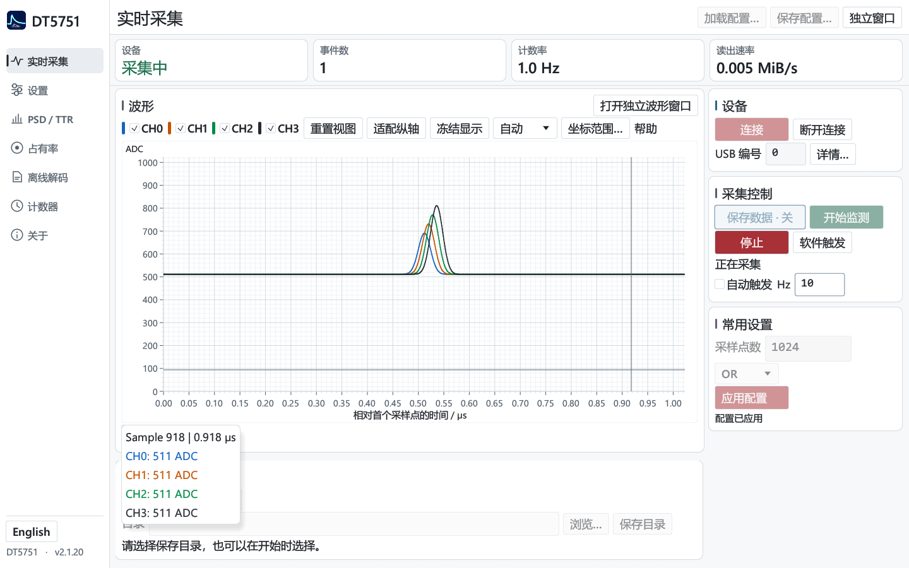
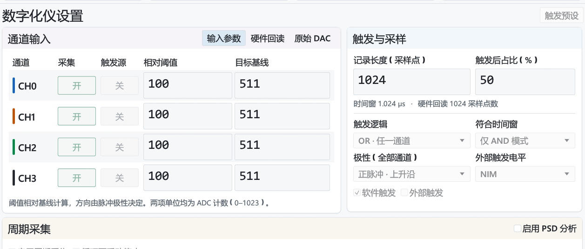
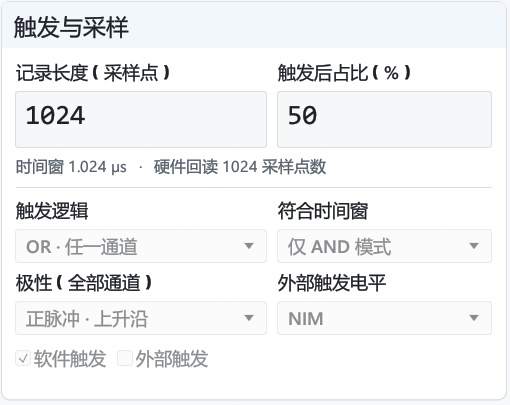
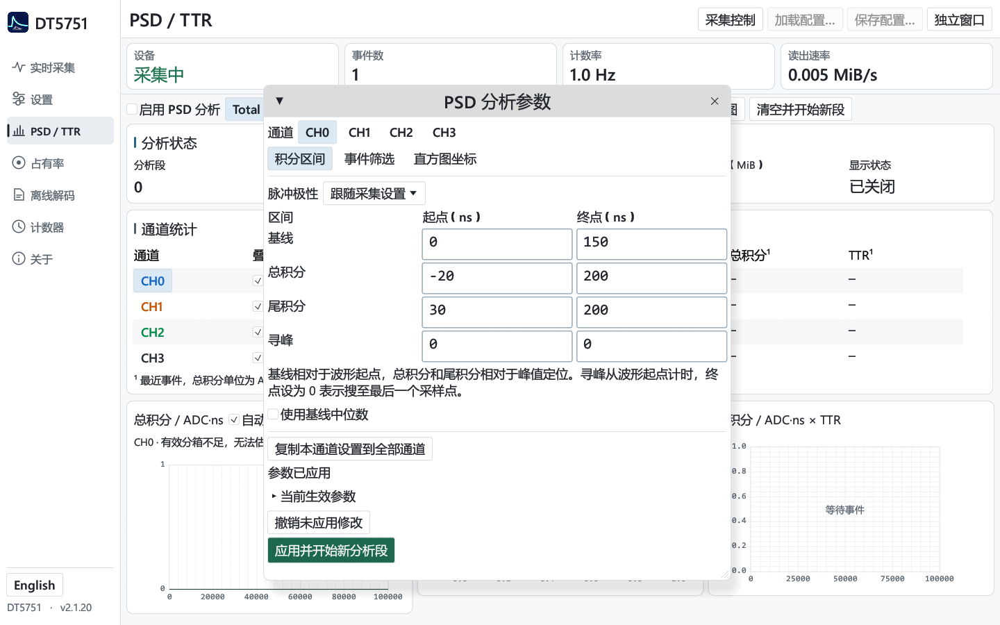
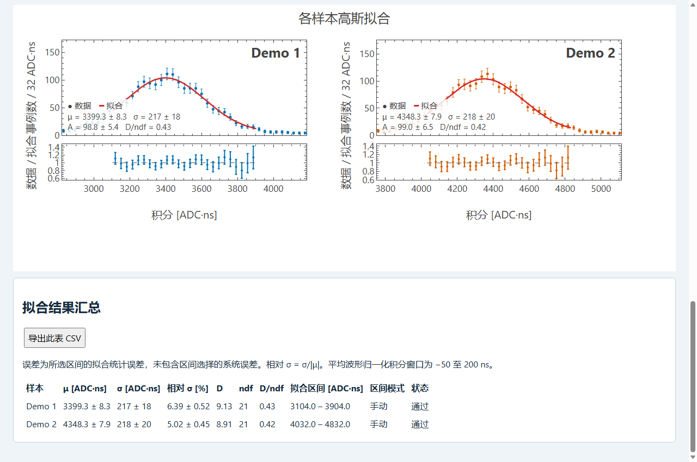

# DT5751 采集与分析使用手册

DT5751 2.1.17 · Light yield 1.3.5 · © 2026 Xiaojie Luo and ChatGPT

## 1. 安装与连接

本程序支持四输入 CAEN DT5751 的普通 1 GS/s 波形采集模式。板卡需要使用 WaveDump 对应的 **D-WAVE（Waveform Recording）固件**。CoMPASS 使用的 DPP 固件（含 DPP-PSD）与本程序不兼容。这里的 PSD 由电脑对波形积分计算。若不清楚板卡固件，请在厂商工具中查看板卡信息。安装程序用于配置电脑，不刷写板卡。

1. Windows 10/11 x64 选择标准安装包，允许管理员权限以安装 CAEN USB 驱动和微软运行库。Windows 7 SP1 x64 选择 Win7 专包，目标机需已有可用的 CAEN USB 驱动和支持 OpenGL 的显卡驱动。Win7 版已通过导入表检查，仍需在目标机验证安装和 USB 取数。
2. 使用光产额分析时，在安装器选择 **Full** 或勾选 **Light yield offline analysis**。插件使用本机现代 Edge 或 Chrome 浏览器。
3. 给板卡供电，以 USB 直连电脑，关闭占用设备的 WaveDump、CoMPASS 或其他采集软件。启动 DT5751，第一块板通常选择 USB 索引 0，点击 **连接**，在连接详情核对型号、序列号和 ROC/AMC 版本。
4. 将探测器信号接到 CH0–CH3 模拟输入，按实际板卡规格检查幅度、极性和终端匹配。TRG-IN 是独立的外部逻辑触发输入。

## 2. 读出第一条波形

1. 在停止状态打开 **设置 → 触发预设 → 软件触发测试**。勾选采集通道，先用短记录（例如 1024 个采样点），点击 **应用配置**。
2. 在实时采集页选择可写的 **父目录**，关闭 **保存数据**，点击 **开始监测**。若弹出目录选择框，选定目录后继续。监测模式仅在内存中预览。
3. 点击 **软件触发**，观察事件数是否增加。启用自动软件触发，设为 **10 Hz**，即可连续观察。软件触发采到的是该时刻的输入，无脉冲时显示基线。要稳定看到探测器脉冲，请使用合适的自触发或同步输入。
4. 鼠标右键框选放大，左键拖动平移，双击恢复。点击 **独立波形窗口** 后可拖到第二屏，F11 切换全屏。修改硬件参数前先停止采集。



模拟采集中的四通道波形。

## 3. 设置基线与相对阈值

在设置页，**采集**决定读出哪些通道的波形，**触发源**决定哪些通道参与产生事例。可以读出某一路而让它仅作观察。每路单独设置相对阈值和目标基线，单位为 10 位 ADC 计数（0–1023）。四路硬件触发极性共用。

停止采集，按输入选择 **正脉冲·上升沿** 或 **负脉冲·下降沿**。在无脉冲的基线段测量基线。若波形靠近量程边缘，先调整目标基线并应用。相对阈值应高于基线噪声起伏、低于待测脉冲幅度。

例如实测基线 **600 ADC**、相对阈值 **100 ADC**，正脉冲的实际触发线是 **700 ADC**，负脉冲是 **500 ADC**。点击应用配置后，软件测量基线并写入阈值。在 **回读** 中核对再开始采集。原始 DAC 码用于调模拟偏移，不能直接当作实测 ADC 基线。



逐通道参数与板级触发设置。

## 4. 进行多通道符合测量

硬件 AND 适用于已验证的波形固件组合 **ROC 4.16 / AMC 0.7**。四个通道可任选两路、三路或四路组成一个全符合组。

1. 将同极性的同步脉冲接入 CH1 和 CH2。在 OR 模式先仅选择 CH1 作为触发源，再仅选择 CH2。两次都应有接近输入重复频率的计数，波形应能清楚越过阈值。
2. 停止后选与极性匹配的 **CH1 AND CH2** 预设，或手动选 **AND · 所选全部**。每个参与通道均勾选采集和触发源。三路或四路符合再勾 CH0、CH3。仅用于观察的通道勾采集即可。
3. 将标称符合窗设为 **64 ns**，核对每路基线和相对阈值，点击应用。可选标称窗为 8–120 ns，步长 8 ns。纯 AND 模式关闭软件、自动软件和外部触发。
4. 开始监测，同步越阈时应有事例。增加一路延迟至符合窗以外，用相同时间比较计数率，并复测两路单独触发。应在波形上测量两路**越过阈值的时间差**。脉冲形状、幅度和硬件时序都会影响实际边界。延迟周期脉冲可验证拒绝行为，测偶然符合率则需要独立信号及相应的计数时间。



切换前的 OR 设置。选择 AND 后可编辑符合窗。

## 5. 记录、周期测量与回放

选择可写父目录，开启 **保存数据**。**压缩 BIN** 适合保存紧凑的原始事例；**WaveDump DAT** 按通道保存带头二进制波形；要逐行阅读可选 **WaveDump TXT**。点击开始记录，结束时正常停止，让软件写完带时间戳的目录及采集清单。

在设置中开启 **周期记录**，填写每周期取数时间（默认 10 分钟）、周期间休眠（默认 0 分钟）和次数，也可设为持续至手动停止。选择父目录并在采集页启动批次。每周期有独立目录；转移数据时保留整个批次和元数据。

停止后可用 **保存配置／加载配置** 复用参数，加载后检查输出目录并应用。若点击开始时检测到改动，可应用新配置或沿用上次已应用的配置。在 **离线解码** 页选择已完成的测量目录或支持的波形文件，可逐事例回放，或将整个输入转换为 TXT 至新的输出目录。

## 6. 设置 PSD/TTR 积分和筛选

先显式开启 **PSD / TTR**，此后收到的事件才进入分析。在分析参数中选择通道、极性及无脉冲基线窗。基线窗从记录的第一个采样点计时，Total 和 Tail 相对于脉冲峰计时。例如基线 **[0,150)**、Total **[−20,200)**、Tail **[30,200)**，单位均为 ns，右端点不计入。峰位两侧须有足够的记录长度，Tail 须在 Total 内。应用参数后开始新的分析分段。

软件扣除基线并统一脉冲方向，再对窗口内样本求和。Total 和 Tail 单位为 ADC·ns，**TTR = Tail / Total**，无量纲。可以对比各通道积分谱、TTR 分布及所选通道的二维图。计数模式下色标表示每个二维分箱的事例数。对 Total 或 Tail 做高斯拟合时，先检查拟合区间是否包含目标峰，再查看 μ、σ 和拟合偏差与自由度之比 D/ndf。

若图为空，先看采集页事件数，再看 PSD 收到、分析和拒绝计数。只有基线的软件触发波形可能被幅度筛选拒绝。通过事例预览核对时间窗、极性、饱和及直方图范围。跳过计数增加表示分析处理未跟上输入。记录时各段保存直方图和拟合 CSV；开启周期拟合汇总可跨周期收集结果。



PSD 工作区中的通道分析参数。

## 7. 监测占有率

进入独立的 **占有率** 页并启用。每路设定基线窗、信号判定窗（均从首采样点起算，单位 ns），以及相对该条波形平均基线的带符号 ADC 阈值。正值判上穿，负值判下穿。信号窗结束设为 0 表示延伸至记录末端。比较样品前点击应用并清零。

占有率等于信号窗内过阈的波形数除以该通道参与统计的总波形数，每条波形最多计一次。比较探测器状态时，保持触发选择、窗口和阈值一致。若用被监测通道自触发，采到的样本会偏向已过阈的脉冲。

## 8. 离线比较光产额

打开 **插件 → 光产额分析**。添加批次目录、单次测量目录或支持的文件。为每个样品填写简明标签，选择记录通道、脉冲极性、积分窗及 Total 或 Tail。不同样品应采用一致的积分窗和测量条件。勾选样品，点击 **分析选中测量**。

先看叠加能谱，再看各样品的高斯拟合和数据／拟合比值。自动模式寻找最右侧合适的峰。若本底或低统计量影响选窗，点击峰位散点检查对应能谱，手动输入拟合上下限并重新拟合。结合 D/ndf 和残差判断拟合质量；μ、σ 的误差是给定拟合区间的统计误差。

平均波形通过恒比定时对齐。原始平均波形用于比较幅度，单位面积归一化波形用于比较形状。可将参照样品标记为重点，在散点图中突出显示。可导出结果表、全精度 CSV、PDF 或交互式 HTML。软件的 **关于** 页可打开随包手册；独立 HTML 报告链接到生成该报告版本的手册。



插件对两组模拟能谱的拟合。

## 9. 将采集波形转换为 ROOT

记录时选择 **压缩 BIN**。取数结束后，在 Linux 或 WSL 上用独立的 **BinaryFileV2ToROOT** 将单次测量或单个周期的波形和触发时间写入 ROOT。 [转换程序](https://github.com/jack595/CAEN_DT5751_ReadoutIntoROOTFile)

安装 Conda 后，首次使用执行以下命令。将最后一行的路径替换为实际输入和新的输出文件名。

```bash
git clone https://github.com/jack595/CAEN_DT5751_ReadoutIntoROOTFile.git dt5751-tools
cd dt5751-tools/cpp/dt5751_bin
CONDA_CHANNEL_PRIORITY=strict conda env create -f environment.yml
conda activate wavedump-binroot
make
make check
./BinaryFileV2ToROOT "/path/to/run/events.bin.gz" "/path/to/output.root"
```

也可以传入原始 BIN 文件或包含它的测量目录。请保留同目录的 `capture.json` 供转换器识别时间戳模式。周期测量每个周期单独转换；省略事件数时读取并检查完整数据流。已有输出文件不会被覆盖。

在 ROOT 中打开输出，查看 `WaveDump` 树。每个条目是一个事例，`waveform_chN` 保存物理通道 N 的原始 ADC 样本，`eventCounter` 是原始事例计数，`triggerTimeTag` 单位为硬件时钟刻度，`triggerTime` 单位为微秒。可用 `WaveDump->GetEntries()` 和采集清单中的事例数核对。

对于按通道保存的 DAT，请使用 [WaveDump DAT 转换器](https://github.com/jack595/CAEN_DT5751_ReadoutIntoROOTFile/tree/HEAD/cpp/wavedump_dat)，输入为计数连续、各通道已对齐的目录。仓库中的 TXT 读取器仅适用于旧式 1029 采样点布局，不能作为任意 GUI 文本波形的通用入口。

[CAEN DT5751](https://caen.it/products/dt5751/) · [CAEN WaveDump](https://caen.it/products/wavedump/) · [D-WAVE](https://caen.it/products/d-wave/) · [CoMPASS](https://caen.it/product/compass/)
